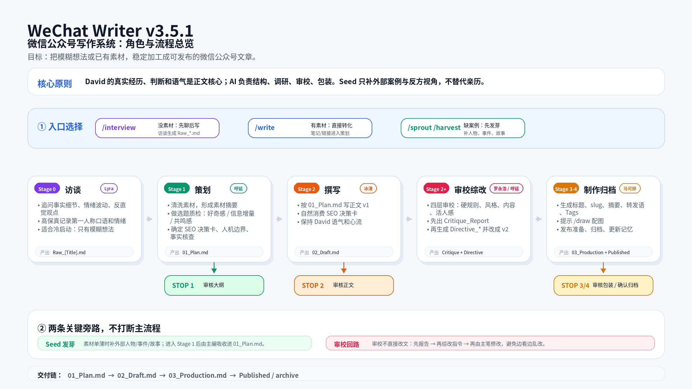
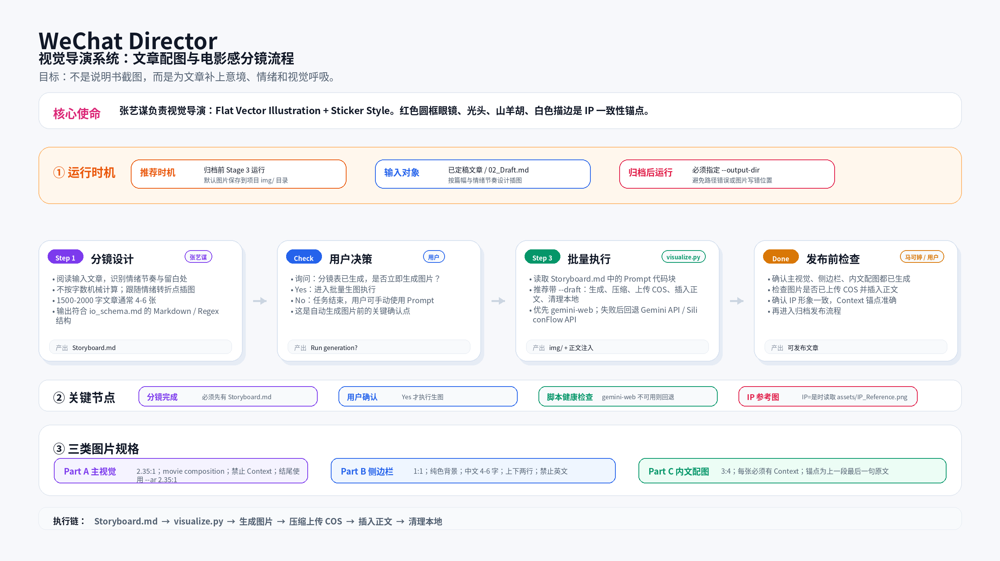

# WeChat Writing Team

[](https://github.com/DavidLam-oss/obsidian-wechat-converter) [Obsidian 微信发布插件](https://github.com/DavidLam-oss/obsidian-wechat-converter) — 写完文章后一键发送到微信公众号草稿箱

微信公众号写作 + 轻日更 + 配图全套 Skill。对接 Claude Code / Codex / Gemini CLI，覆盖从"记录日常"到"深度文章"到"配图生成"的完整创作链路。

**当前版本：wechat-writer v6.0.0-xingchen / wechat-daily v2.0.0-xingchen**

---

## WeChat Writer（深度写作 Skill）

写作流水线 Skill，支持 2 个入口，覆盖从"有想法"到"发布归档"的完整生命周期。**v6.0.0-xingchen**。



### 入口一览

| 入口 | 场景 |
|------|------|
| `/interview "话题"` | 有想法，需要梳理 |
| `/write "标题"` | 已有素材或标题；也可说"用日记写深度文章"触发 Diary 桥接 |

所有文章均为**原生模式**：个人经历/体感为核心，外部素材零引入或仅点缀。

### 核心功能

- **6 角色协同**：首席记者 (Lyra) → 研究员 (李长征) → 主编 (呼延雷锋) → 主笔 (冰清) → 顾问 (罗永浩) → 制作人 (马可婷)
- **2 个入口**：`/interview` `/write`，覆盖访谈挖掘和素材直写两种场景
- **Diary 桥接**：用户说"用日记写深度文章"时，直接从 `diary/` 读取素材进入 Stage 1
- **四层审校**：L1 硬规则 → L2 风格一致性 → L3 内容成立度（含框架健康度）→ L4 老友感终审
- **标题设计清单**：5 条思考路径 + C/E/V 三维评分 + 淘汰规则 + 推荐档位
- **金句提炼**：7 种打磨手法（关联词/修辞/搜词/拆字/混搭/段子/押韵）
- 内置 SEO 关键词调研（可搭配 `wechat-index-query` 使用）

### 目录结构

```
.claude/skills/wechat-writer/
├── SKILL.md                        # 主入口（Skill 触发点，v6.0.0）
├── scripts/
│   ├── config_check.py             # 首次使用前运行，检测环境配置
│   ├── cleaner.py                  # 素材清洗 → Cleaned_*.md
│   ├── research.py                 # 调研报告格式化 → Research_Report.md
│   ├── review_toolkit.py           # 审校报告渲染（critique/directive/feedback）
│   └── archive.py                  # 发布归档 + 更新索引 + 生成文章卡片
├── references/
│   ├── core_personas.md            # 6 大核心角色定义
│   ├── routine_plan.md             # Stage 1 策划完整操作步骤
│   ├── template_01_plan.md         # 策划案示例样本（含闪亮点/落点）
│   ├── title_design_checklist.md   # 标题设计清单（5 路径 + C/E/V 三维评分）
│   └── io_schema.md                # I/O 规范 + 脚本契约
├── knowledge/
│   ├── style_guide.md              # 星辰个人写作风格（体感叙事五锚点 + 氛围感三技法 + 主笔工具箱）
│   ├── ai_smell_guide.md           # 去 AI 味审校清单（L1-L4 四层校验）
│   ├── brand_positioning.md        # 编码人生.lab 品牌定位
│   ├── team_memory.md              # 团队记忆与踩坑记录
│   └── published_article_index.md  # 已发布文章索引
└── tests/                          # test_archive.py + test_review_toolkit.py
```

---

## WeChat Daily（轻日更 Skill）

轻量日更 Skill，1 个轻写手角色，5 步轻量流程，记录生活中的美好。**v2.0.0-xingchen**。

### 入口

| 入口 | 场景 |
|------|------|
| `/daily` | 写一篇轻日更；可指定日期（"用昨天的日记写日更"） |

### 核心功能

- **5 步轻量流程**：素材采集 → 成文 → 用户确认（★ 唯一人工门禁）→ 配图（可选）→ 发布归档 → 选题雷达扫描
- **轻写手角色**：复用冰清语感，不走 6 角色协同
- **去 AI 味自查**：写作时执行，不编造、不硬凑，有画面就写，没有就短
- **Diary → Daily 链路**：读取 `diary/` 原始日记作为素材，支持指定日期
- **选题雷达**：每次运行扫描 `diary/`，把有深挖价值的候选写入 `topic_radar_pool.md`，反哺 wechat-writer
- 共用 wechat-director 生图引擎（默认只做封面+侧边栏，不做内文配图）

### 目录结构

```
.claude/skills/wechat-daily/
├── SKILL.md                        # 主入口（Skill 触发点，v2.0.0）
├── scripts/
│   ├── archive_daily.py            # 发布归档 + HTML 生成 + 索引更新 + 历史清理
│   └── draw_daily.py               # 配图包装（复用 wechat-director 引擎）
├── references/
│   └── daily_beauty_routine.md     # 5 步完整流程 + 脚本契约
└── tests/                          # test_archive_daily.py
```

---

## WeChat Director（配图 Skill）

视觉导演 Skill，对接 `/draw`（配图生成），由"张艺谋"角色驱动，为文章设计电影感分镜。

适用于文章配图生成，支持 Gemini / GPT-Image2 API。



**核心功能：**
- `/draw` — 阅读文章草稿，设计 Storyboard 分镜表
- 支持 Gemini / GPT-Image2 API（可选）
- 批量生成：封面、侧边栏、内文配图
- 内嵌 TinyPNG 压缩 + 腾讯云 COS 上传（可选）

**目录结构：**
```
.claude/skills/wechat-director/
├── SKILL.md                        # 主入口
├── scripts/
│   ├── config_check.py             # 首次使用前运行，检测生图配置
│   └── visualize.py                # 批量生图 → 压缩 → 上传 COS → 注入正文
├── references/
└── assets/
    └── IP_Reference.png             # IP 形象参考图
```

---

## 快速开始

### 1. 安装

把这些文件放入你的 Claude Code / Codex / Gemini CLI 工作区。`SKILL.md` 会被自动识别为 Skill 入口。

### 2. 首次配置（推荐先运行）

```bash
# Windows 环境请使用 python 而非 python3
python .claude/skills/wechat-writer/scripts/config_check.py   # 检测写作环境
python .claude/skills/wechat-director/scripts/config_check.py  # 检测生图配置
```

### 3. 轻日更（WeChat Daily）

```
/daily                   # 写一篇轻日更（读取今天的 diary/）
/daily 用昨天的日记写     # 指定日期
```

### 4. 深度写作（WeChat Writer）

```
/interview [话题]        # 访谈模式，从零挖掘素材
/write [标题]            # 素材模式，已有素材直接写稿
/write [标题] --from-stage N  # 从任意阶段继续
/write 用日记写深度文章    # Diary 桥接：从 diary/ 读取 → 深度文章
```

### 5. 配图（WeChat Director）

```
/draw                   # 输入 Storyboard.md 路径，自动生成分镜
```

### 6. SEO 关键词调研（可选）

安装 [`wechat-index-query`](https://github.com/mileson/wechat-index-query) Skill（仅支持 macOS，需手动打开微信指数小程序），在策划阶段查微信指数找上升搜索词。

---

## 配置说明

生图需要配置 API key（Gemini 或 GPT-Image2），写入 `conductor/api_keys.json`：

```json
{
  "gemini": {
    "base_url": "https://generativelanguage.googleapis.com",
    "model": "gemini-3.1-flash-image-preview",
    "api_key": "your-key-here"
  },
  "gpt-image2": {
    "base_url": "https://api.openai.com/v1",
    "model": "gpt-image-2",
    "api_key": "your-key-here"
  }
}
```

TinyPNG 压缩和腾讯云 COS 上传为可选功能。

gemini-web 重新登录刷新cookie的修复命令:
  cd .claude/skills/wechat-director/vendor/baoyu-danger-gemini-web/scripts
  GEMINI_WEB_DATA_DIR=<repo>/.gemini/wechat-director/gemini-web/data \
  GEMINI_WEB_COOKIE_PATH=<repo>/.gemini/wechat-director/gemini-web/cookies.json \
  GEMINI_WEB_CHROME_PROFILE_DIR=<repo>/.gemini/wechat-director/gemini-web/chrome-profile \
  bun run main.ts --login

  或者通过 visualize.py 的快捷方式：
  PYTHONIOENCODING=utf-8 python .claude/skills/wechat-director/scripts/visualize.py --gemini-web-login

---

## 需要用户个人化的文件

以下文件位于各 skill 的 `knowledge/` 和 `references/` 目录，克隆后建议按需替换：

| 文件 | 说明 |
|------|------|
| `wechat-writer/knowledge/style_guide.md` | 写作风格指南（星辰的个人文风——真诚、自然、有温度） |
| `wechat-writer/knowledge/brand_positioning.md` | 公众号品牌定位（编码人生.lab） |
| `wechat-writer/knowledge/team_memory.md` | 团队记忆与踩坑记录 |
| `wechat-writer/knowledge/published_article_index.md` | 已发布文章索引 |
| `wechat-writer/knowledge/素材库.md` | 私有灵感、金句、碎片观察 |
| `wechat-writer/references/bio_footer.md` | 文末个人 IP 介绍文案（daily 也共用） |
| `wechat-writer/knowledge/topic_radar_pool.md` | 选题雷达候选池（daily 写入，writer 消费） |

---

## 依赖

- Python 3.8+
- Pillow（图片处理，可选）
- qcloud-cos-python-sdk-v5（腾讯云上传，可选）
- Obsidian CLI（archive 功能需要，可选）

---

## License

MIT
